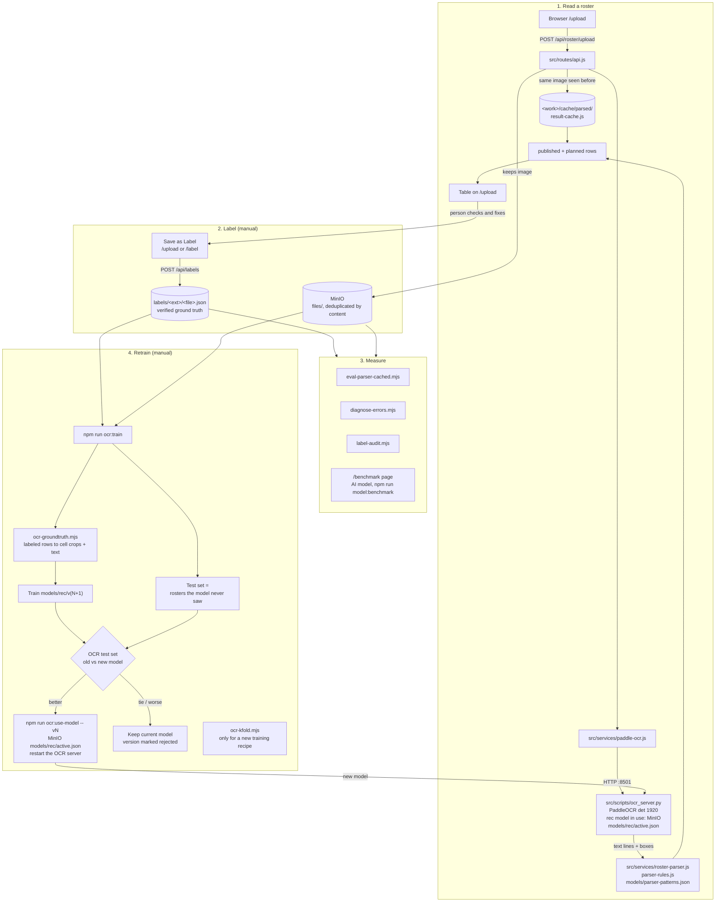

# Node OCR

Reads crew roster screenshots and returns the rows of the two roster tables,
**"Published roster"** and **"Rest of this roster is planned"**, as structured
data (`date, day, duty, dep, begin, end, arr`). Other text on the page is ignored.

Current state (2026-10-08): recognition model **v4** (in use since 2026-10-15: v5; the versions are in MinIO, `models/rec/`), parser
row accuracy 97.1% on the labeled rosters (95.6% on 16 rosters the model never
trained on, before the 2026-10-07 parser fixes). Nothing learns or retrains on its own: the model and parser only change
when you run a command and choose to switch.

**New here?** Jump to [Getting started](#getting-started) to install and run it.

## Architecture



Same diagram as plain text (for terminals):

```
 ┌──────────────────────────── 1. READ A ROSTER ─────────────────────────────┐
 │                                                                           │
 │  Browser /upload ──POST /api/roster/upload──> src/routes/api.js               │
 │                                              │  same image seen before?   │
 │                                              ├─yes─> <work>/cache/parsed/ │
 │                                              │      (result-cache.js)     │
 │                                              │                            │
 │                                              ▼                            │
 │                                    src/services/paddle-ocr.js                 │
 │                                              │ HTTP :8501                 │
 │                                              ▼                            │
 │                                    src/scripts/ocr_server.py                  │
 │                                    PaddleOCR det (1920) +                 │
 │                                    rec model in use (MinIO,               │
 │                                    models/rec/active.json)                │
 │                                              │ text lines + boxes         │
 │                                              ▼                            │
 │                                    src/services/roster-parser.js              │
 │                                    (+ parser-rules.js,                    │
 │                                     models/parser-patterns.json)          │
 │                                              │                            │
 │                                              ▼                            │
 │          { published: [...], planned: [...] } ──> table on /upload        │
 └───────────────────────────────────┬───────────────────────────────────────┘
                                     │ a person checks / fixes the table
                                     ▼
 ┌──────────────────────────── 2. LABEL (manual) ────────────────────────────┐
 │  a roster joins the data (MinIO) via an accepted suggestion               │
 │  "Save as Label" on /upload or /label ──POST /api/labels──>               │
 │      labels/<ext>/<file>.json in MinIO (verified ground truth)            │
 └────────────┬───────────────────────────────────────┬──────────────────────┘
              │                                       │
              ▼                                       ▼
 ┌────── 3. MEASURE ───────┐  ┌──────────── 4. RETRAIN (manual) ─────────────┐
 │ /benchmark (AI model,   │  │ npm run ocr:train                        │
 │   OCR)                  │  │ ├ test = rosters the model never saw         │
 │                         │  │ ├ ocr-groundtruth.mjs:         │
 │                         │  │ │   labeled rows -> cell crops + text        │
 │ eval-parser-cached.mjs  │  │ ├ train -> models/rec/v(N+1)                 │
 │ diagnose-errors.mjs     │  │ └ OCR test set with old + new model          │
 │ label-audit.mjs        │  │     -> better / tie / worse                  │
 │                         │  │                                              │
 └─────────────────────────┘  │ better? npm run ocr:use-model -- vN              │
                              │   -> MinIO active.json, restart OCR server   │
                              │   -> back to 1 with the new model            │
                              │                                              │
                              │ new recipe? ocr-kfold.mjs            │
                              └──────────────────────────────────────────────┘
```

The four steps:

1. **Read.** `ocr_server.py` finds the text lines and reads them with the fine-tuned
   model. `roster-parser.js` turns those lines into rows of the two tables.
2. **Label.** Only a person writes labels.
3. **Measure.** Scores always compare against `labels/`.
4. **Retrain.** Run by hand. A new model version is used only after
   `ocr:use-model` switches to it.

## Getting started

### Requirements

| | Version | Notes |
|---|---|---|
| Node.js | **20.6+** (tested on 20.18) | `npm start` uses `node --env-file` |
| Python | **3.11** (tested on 3.11.3) | for the PaddleOCR server |
| GPU (optional) | NVIDIA, CUDA 11.8 runtime | tested on a GTX 1660 Ti (6 GB). The CUDA/cuDNN DLLs come from pip, no separate CUDA install needed. Without a GPU the server falls back to CPU (much slower). |
| OS | Windows 10/11 | the `npm run ocr:server` / `ocr:check` scripts call `.\.venv\Scripts\python`; on Linux/macOS run them with `.venv/bin/python` (see below) |

### 1. Get the code and install

```powershell
git clone https://github.com/thuannd17/node-ocr.git
cd node-ocr

npm install

python -m venv .venv
.\.venv\Scripts\pip install -r src/scripts/requirements.txt
```

No NVIDIA GPU? In `src/scripts/requirements.txt` swap `paddlepaddle-gpu==2.6.2` for
`paddlepaddle==2.6.2` (the line is already there, commented out) and drop the
`nvidia-*` lines before installing.

Linux/macOS: `python3.11 -m venv .venv && .venv/bin/pip install -r src/scripts/requirements.txt`
(use the CPU package on macOS).

### 2. Configure

```powershell
copy .env.example .env      # Linux/macOS: cp .env.example .env
```

The defaults work as is; everything runs offline. All settings are
listed in [`.env`](#env) below.

### 3. Check the OCR runtime

```powershell
npm run ocr:check           # Paddle/PaddleOCR versions, GPU or CPU, test init
```

### 4. Run

Two processes, in two terminals:

```powershell
npm run ocr:server          # terminal 1: PaddleOCR on http://127.0.0.1:8501 ("Ready" when loaded)
npm start                   # terminal 2: app on http://localhost:3000
```

Linux/macOS terminal 1: `.venv/bin/python -u src/scripts/ocr_server.py`.

Open <http://localhost:3000>, go to **Upload & OCR** and drop a roster screenshot.
The first OCR after starting the server takes a few seconds longer (model warm-up);
after that about 1 s per image on the GPU above.

Quick checks: <http://127.0.0.1:8501/health> (device, queue) and
<http://127.0.0.1:8501/stats> (requests served, queue/inference time).

### 5. Data: MinIO (not in git)

Roster files and labels are real crew rosters (personal data). Since 2026-10-19 they live
**only in MinIO**; the app has no data folder of its own. The code that reads and writes them is
kept apart in `src/services/storage/` (a library, no service of its own), used through `src/services/media-client.js`.

```
app server (src/index.js, scripts) ── src/services/storage/ (MINIO_*) ─> MinIO bucket roster-ocr
        │                                                       files/<ext>/<name>          roster files
        └── local mirror MEDIA_CACHE_DIR                        labels/<ext>/<name>.json    verified labels
            (default: <ROSTER_WORK_DIR>/media)                   suggestions/<id>/...        correction suggestions
            files/<ext>/<name>, labels/<ext>/<name>.json        trash/<date>/...            deleted on /label
```

Only MinIO has to run (`npm start` connects to it). A MinIO key limited to the bucket is enough;
there is no need for the root key.

```bash
npm run media:import    # one-time: copy the old fake-data/, labels/, suggestions/ folders into MinIO (checked; deletes nothing)
```

- **Writes** (save a label, accept a suggestion, delete a file) go to MinIO first, then to the mirror.
- **Reads** that need real files (the OCR server reads by path, Python, sharp, training, benchmarks) use the **local mirror**: `syncMedia()` downloads only what changed (MD5 = MinIO ETag, `.manifest.json`) and removes what is gone. It runs when the app starts, before the file lists of /label, before benchmarks, and at the start of every CLI script (`syncForScript`; `MEDIA_OFFLINE=1` uses the mirror as it is). The mirror can be deleted at any time.
- `MEDIA_BACKEND=fs` (`MEDIA_FS_DIR`) keeps the data in a folder instead of MinIO: the tests use it.
- Admin page **/media**: every roster file in MinIO, labeled or not, with a preview; delete one file or all unlabeled ones (to trash/<date>/).

**ACARS pictures** (photos of the cockpit's ACARS / AOC OOOI page) are a second collection in a bucket of their own,
`ACARS_BUCKET` (default `acars-ocr`), laid out flat and under the names they were put there with:
`files/<name>` and `labels/<name>.json` (`{ flt, date, dept, dest, out, off, on, in, info }`; the date as much of it as the screen prints: `11 Nov 25`, `28 May`, or only the day `14` from `QFA0057/14`), deleted ones in `trash/<date>/`.
The app mirrors it like the roster data (`acars` in `src/services/media-client.js`, mirror `<work>/acars/`).
Put new pictures there with the MinIO console; label them on /label (**ACARS files**).

Code never builds these paths itself: `src/utils/data-files.js` (`DATA_ROOT`, `LABELS_ROOT`, `listData`, `dataFile`,
`labelFile`, ...) resolves a file name to its place in the mirror, so training, benchmark and
the app all see the same files. File names are unique across folders, so caches,
`exports/` and `models/rec/*/model.json` refer to files by name only.

Upload and OCR work without any data. `/label` and `/benchmark` only have
something to show once images are uploaded and labeled; to reuse an existing
dataset, copy both folders from the machine that has them.

**Trained AI models** are in MinIO too: `models/ai/<id>/` (one folder per version) and
`models/ai/active.json` (the one in use). The app mirrors them at start and on /models
(`src/services/ai-models.js`, `syncModels`); Train, Activate, Delete and the AI model benchmark write to MinIO.
OCR training checkpoints (only needed to resume a training run) are archived there as well:

```bash
npm run models:archive -- list models/                                     # what is in MinIO under models/
npm run models:archive -- pull models/rec/v4/checkpoint/ <folder>           # get one back
npm run models:archive -- push <folder> models/rec/<ver>/checkpoint/        # archive one
```

**Nothing is written inside the project while it runs.** Everything the app and the scripts make goes to the
work folder `ROSTER_WORK_DIR` (default `<system temp>/roster-ocr-work`, `src/utils/paths.js`), written `<work>` below:

| `<work>/` | What |
|---|---|
| `media/` | mirror of the roster files and labels (`MEDIA_CACHE_DIR`) |
| `acars/` | mirror of the ACARS pictures and their labels (`ACARS_CACHE_DIR`) |
| `models/` | mirror of the trained AI models |
| `cache/` | OCR and parse results kept to run faster again (`ocr/`, `parsed/`, `rec-lines/`, ...) |
| `exports/` | training datasets built from the labels (`ocr-lines/`, `ocr-lines-acars/`, `pdf-tokens/`, `image-tokens/`, `acars-tokens/`, `recognition-groundtruth/`, ...) |
| `uploads/`, `tmp/` | files being read, OCR crops, load tests (short-lived) |
| `train/` | OCR k-fold runs |
| `pretrained/` | the PaddleOCR base model for retraining (downloaded, see [Recognition model versions](#recognition-model-versions)) |

All of it can be deleted: the data and the models come back from MinIO, the rest is rebuilt
(OCR caches and datasets by running the scripts again).

### Troubleshooting

| Symptom | Fix |
|---|---|
| Upload says *PaddleOCR server is not reachable* | start `npm run ocr:server` and wait for `Ready`; if it runs elsewhere set `OCR_SERVER_URL` |
| Upload says *The OCR server is busy* | more than `OCR_MAX_QUEUE` (default 4) requests were waiting; retry, or raise `OCR_MAX_QUEUE` |
| `EADDRINUSE` (app) or `WinError 10048` / *Address already in use* (OCR server) | port 3000 / 8501 already used (another copy running?): stop it, or change `PORT` / `OCR_SERVER_PORT` (+ `OCR_SERVER_URL`) |
| OCR server exits with a CUDA/DLL error | rerun `npm run ocr:check`; reinstall `src/scripts/requirements.txt`, or use the CPU package |
| `npm start` fails with `bad option: --env-file` | Node is older than 20.6 |
| Styles missing after an update | restart `npm start` and hard-reload the page (Ctrl+F5) |

## Docker

Two images, started together by `docker-compose.yml`:

| Image | Built from | What it runs |
|---|---|---|
| `roster-ocr-app` | `Dockerfile` | the web app (Node 20) + Python 3.11 with scikit-learn for the learned roster model (`docker/requirements-app.txt`) |
| `roster-ocr-ocr` / `roster-ocr-ocr-gpu` | `docker/ocr.Dockerfile` | the PaddleOCR server, CPU or NVIDIA GPU (build args), which downloads the recognition model in use from MinIO into `/work` at start (`src/scripts/rec_model.py`, `docker/requirements-ocr.txt`); the stock detector is downloaded on first start into the `paddle-models` volume |

```bash
docker compose up -d --build                                                    # CPU OCR, http://localhost:3000
docker compose -f docker-compose.yml -f docker-compose.gpu.yml up -d --build    # OCR on the GPU
APP_PORT=3004 docker compose up -d                                              # when port 3000 is taken
docker compose logs -f app ocr
```

- Settings come from `.env`; compose overrides what differs in a container (`HOST`, `OCR_SERVER_URL=http://ocr:8501`, `ROSTER_WORK_DIR=/work`, `MINIO_ENDPOINT=host.docker.internal` for a MinIO running on the host).
- **No roster data in the images or in this folder.** The data and the trained AI models are in MinIO; the app's mirror of them and its caches are the `work` volume (`/work`). `.dockerignore` keeps the old data folders, `.env` and the other models out of the app build.
- The app sends **file paths** to the OCR server, so the `ocr` container mounts the same `work` volume at `/work` (read-only).
- The OCR image uses **Paddle 3.0.0**: the Linux CPU wheel of 2.6.2 crashes on CPUs without AVX-512 (AMD Ryzen). On CPU, Paddle 3 turns oneDNN on by default, which makes PaddleOCR 2.9 fail from the 2nd or 3rd image ("could not execute a primitive"), so the Dockerfile patches PaddleOCR to turn it off. Measured 2026-10-19 with 2 CPUs in Docker Desktop: **~35-40 s per roster image**, same rows as the labels. More CPUs for Docker (Docker Desktop settings / `.wslconfig`) make it faster.
- **GPU** (`docker-compose.gpu.yml`): `paddlepaddle-gpu==3.0.0` for CUDA 11.8 (its CUDA / cuDNN come as pip packages, so no CUDA base image), and a GPU reservation for the `ocr` service. Docker Desktop on Windows passes an NVIDIA GPU through WSL 2 (check: `docker run --rm --gpus all nvidia/cuda:11.8.0-base-ubuntu22.04 nvidia-smi`). Stop the OCR server running outside Docker first when it uses the same GPU.

## Pages

| Page | Purpose |
|---|---|
| `/upload` | **Try the AI model**: every uploaded roster **image or duty-plan PDF** is read by the learned model (images: PaddleOCR lines -> model), never by the parser and never answered from a saved label. Uploads are **only read, never stored**. If the rows are wrong, **Suggest a correction** sends the file, an optional note and the rows the model read to the admins (`POST /api/roster/suggestions`, kept in `suggestions/<id>/`, git-ignored). The page is read-only and public: it only uses the public API and never links to or calls the admin pages (/label, /benchmark, /models) or their APIs; admin pages may link to it. The toolbar holds the file picker (or drop a file anywhere) and, once a result is shown, **↻ Re-read** (read again, e.g. after retraining). An image-only PDF (no text layer) is read by OCR: a duty plan by the parser (the model has no words for it); any other one, e.g. a Ryanair eCrew roster screen printed to PDF, has its pages stacked into one tall roster picture that the model reads as an image (and, once labeled, trains on as an image). A PDF shows the PDF and 12 columns; empty optional columns (DC, Reg., AC, Crew) are hidden. |
| `/acars` | **Read an ACARS picture** (public): **Scan** takes a photo (the phone's camera), **Upload a picture** picks one (or drop / paste it). The AI model reads it (OCR + the model's ACARS fields, `POST /api/acars/read`): **Flt No, Date, Dept, Dest, Out, Off, On, In** and **Info** (`[Flight: 02:35] [Block: 02:56]`); **Copy** copies them as text. The picture is only read, never kept. It needs a model version trained with labeled ACARS pictures (/models shows "ACARS" among its training files); an older version answers 409 with what to do. |
| `/label` | **Correction suggestions** from /upload on top (pending first; *Show handled ones* for the rest): 👁 opens the file, **Label it** adds it to the data (MinIO, deduplicated) and opens it with the rows the model read as a starting point (not saved until Save), **Dismiss** deletes the file and keeps the record. Below: folder tree of `fake-data/` (one folder per extension; unlabeled 🆕 first, byte-identical image copies hidden unless asked). Hovering a file shows 🗑: it removes the file from the dataset (after a confirm) by moving it and its label to `trash/<date>/` in MinIO (its cached OCR result is dropped). Clicking a file opens a popup (Esc / × closes; drag the bar in the middle to resize) with the file next to its label as editable Published / Planned tables (one cell per field, add / insert / delete rows; Enter moves down a column); the label is still saved as JSON (**{ } JSON** shows it). Making ground truth: **Auto-fill** proposes the rows with **Parser** (OCR + `roster-parser.js` for an image, the PDF parser for a PDF) or **AI model** (chosen in the list next to it), and says how many rows match the saved label; check, fix, save. Ctrl+S saves, Alt+↑/↓ moves between files. `/label?name=<file>` opens one. A second folder, **ACARS files**, lists the ACARS pictures (bucket `acars-ocr`): the popup shows the picture next to a form of 9 fields (Flt No, Date, Dept, Dest, Out, Off, On, In, Info; times HH:MM as printed), with the same Auto-fill (**Parser**: label words like OUT / FLT NO / ORIG/DEST and the value under or after them, `src/services/acars.js`; or **AI model**), Save and 🗑. |
| `/benchmark` | Two scores against the labels. **1. Text recognition from images (OCR)**: PaddleOCR alone on every labeled image (`npm run ocr:benchmark`): each labeled cell (date, day, duty, dep, begin, end, arr; a day's date/weekday once) is looked for in the OCR lines; cells read exactly and characters right, per field and per image with the misread cells. **2. Reading roster data per file type**: the AI model, read as on /upload (`npm run model:benchmark -- --types=image,pdf,csv,xls,xlsx,txt`), with a score per file type; tick the types to run. A run of only some types of a kind does not overwrite the score /models shows. Each file lists its differences from the label. **Review & fix** on a file opens the /label editor in a popup over the page (`/label?embed=1&review=1&name=<file>`): for an image, the table is the label and cells where the model differs are marked (yellow, model value underneath: click to take it), label rows the model missed are blue, rows only the model has are struck through (**+ label** adds one); a PDF opens without the marks. A saved label shows "✓ label saved": run the benchmark again to update the scores. **3. Reading ACARS pictures**: the AI model on every labeled ACARS picture, read as on /acars (`npm run acars:benchmark`): fields right per field (times compared as HH:MM, Info as its two times) and pictures fully right; the score is saved with the model version (/models). |
| `/calendar` | Month / list calendar of `.ics` files, read in the browser (nothing is uploaded). On `/upload`, **Export .ics** downloads the shown file's rows as iCalendar (Google Calendar, Outlook, Apple Calendar) and **View calendar** opens them here (`src/views/assets/ics.js`: `Z` times are UTC, `L`/`LB`/`B` local times are floating, rows without times are all-day, Planned rows are TENTATIVE; a check-in .. check-out (C/I..C/O, CHECK-IN..CHECK-OUT) is one duty event with its flights / sims / hotel inside it (RELATED-TO), rows without a check-in stand alone; a hotel lasts from the end of the event before it to the start of the event after it, nights in a row at one hotel are one event). Times can be shown in UTC or this computer's zone. |
| `/route-map` | The flights of the calendars opened on /calendar (its **Route map** button) on a world map (Leaflet + OpenStreetMap), or on a **globe** (**Map | Globe**; MapLibre GL in its globe projection, `/assets/maplibre` from npm maplibre-gl (6.x: its ES module `maplibre-gl.mjs`; 5.x: `maplibre-gl.js`), loaded only when the globe is shown; drag to turn it, the view is remembered): each flight from its departure to its arrival along the great circle, **one colour per roster** (the calendar's colour; click a roster in the legend to hide / show it), line width by how often the route is flown. A month filter, Planned flights on / off, airport codes on / off; a table of the routes (flights, great-circle distance, rosters; click one to zoom to it). A flight is an event `<flight no> DEP → ARR` (ground duties without a number, like `GT LTN → STC`, are left out); airports come from `/api/airports`. Read in the browser from the calendars /calendar keeps (`localStorage`), nothing is uploaded. |
| `/airport` | Airport lookup by IATA, ICAO, FAA, WMO code or name / city / country: codes, coordinates, elevation, city, country, time zone, a map (Leaflet + OpenStreetMap) and a 7-day forecast (Open-Meteo, no key, cached 30 min by the server). The airport codes in an event's details on `/calendar` link here. Data: `data/airports.json`, rebuilt by `npm run airports:update` (OurAirports + NOAA ISD for WMO station numbers). ICAO is the airport's id; a WMO number belongs to a weather station, not the airport. |
| `/night-time` | Night time of a flight: departure / arrival (airport code or "lat, lon"), off-block and on-block in UTC. The aircraft flies the great circle at a constant speed; the sun altitude is taken at its position every 30 s with SunCalc and each day/night edge is bisected to the second (`src/views/assets/night.js`). Night = sun below −6° (end of civil twilight: ICAO / EASA / FAA) or below −0.833° (sunset to sunrise). Shows night / day / block time, take-off and landing by day or night, the route on a map coloured by night and day with the points where night starts and ends, and the sun altitude over the flight. Flights with UTC times on `/calendar` link here. |
| `/media` | Admin. The roster files as **MinIO** keeps them: the list (filter by type and labeled / not labeled) and a preview of the one clicked. **Delete** moves a file and its label to `trash/<date>/` in MinIO; **Delete all unlabeled** does that for every file without a label (of the type chosen). `/storage` redirects here. |
| `/api-docs` | Public API reference for other apps (Swagger UI over `docs/openapi.json`, also served as `/api/openapi.json`): read a roster of any type, image, PDF, CSV, Excel or TXT (`POST /api/roster/upload`, field `file`), read an ACARS picture (`POST /api/acars/read`), suggest a correction (`POST /api/roster/suggestions`), roster rows to .ics (`POST /api/calendar/export`), airports and weather (`GET /api/airports...`), night time (`POST /api/night-time/calc`). The last two tools run the same code as the pages (`src/routes/tools-api.js`). |

**Public and admin.** The topnav and the home page keep the public tools (Upload, ACARS, Calendar, Airport, Night Time, API Docs) apart from **Admin** (Label, Benchmark, AI Models). Admin is only separated for now: there are no accounts yet, so its pages and APIs are still open; protect them before exposing the app.

**Phones and tablets.** Every page is responsive (`src/views/assets/app.css`): below 1100px the public links fold into a menu under ☰ (`src/views/assets/nav.js`), side-by-side panels stack, wide tables scroll inside their box, and a table marked `stack-sm` (the versions on /models) turns each row into a card on a phone. /acars has **Scan** for the phone's camera.

**Language.** The pages are in English by default; **EN / VI** on the top bar switches to Vietnamese (kept in this browser and in a `lang` cookie, so server messages follow). English text is written in the code; all Vietnamese is in `src/views/assets/i18n/vi.js` (English text → Vietnamese, `{name}` placeholders kept). Page code calls `__("English text", { params })`; static HTML is translated on load when its text, `title`, `placeholder` or `aria-label` is exactly a key (`data-i18n` for a sentence with markup); the server translates with `req.__()` and the JSON `error` / `notices` it sends (`src/utils/i18n.js`). `tests/i18n.test.js` checks the placeholders and that no Vietnamese is left in the page code.

New rosters: uploads are only read; a roster joins the data (MinIO, deduplicated by content) when an admin accepts its correction suggestion. A label
is written only when a person presses **Save as Label**.

## API

| Route | Description |
|---|---|
| `POST /api/roster/upload` | public: multipart field `file`, any roster type (image, PDF, CSV, XLS, XLSX, TXT); the server picks the reader (`src/routes/roster-api.js`) and answers one shape (`readMode`, `source`, `period`, `notices`, both tables; `?preview=1` adds `previewHtml` for CSV / Excel / TXT); no label information; the file is not kept |
| `POST /api/acars/read` | public: multipart field `file` (JPG, PNG, BMP, JFIF) -> `{ fields: { flt, dept, dest, out, off, on, in, info }, timings, model, ms }`, read by the AI model (`src/routes/acars-api.js`); 409 when the model in use was not trained on ACARS pictures; the picture is not kept |
| `GET /api/acars/files`, `GET /api/acars/raw?name=`, `GET`/`POST /api/acars/labels?name=`, `GET /api/acars/parse?name=&engine=parser\|model`, `DELETE /api/acars/files?name=` | admin (/label ACARS files): the pictures, their labels, Auto-fill, delete to the trash |
| `POST /api/roster/suggestions` | public: multipart `file`, `note?`, `rows?` (JSON) -> `201 { id }`; the only way an uploaded roster is kept |
| `GET /api/media/status`, `GET /api/media/items`, `GET`/`DELETE /api/media/file?name=`, `POST /api/media/delete-unlabeled` | admin (/media): MinIO, the files, deleting to the trash (`src/routes/media-api.js`) |
| `GET /api/suggestions?status=pending\|accepted\|dismissed\|all`, `GET /api/suggestions/:id[/file]`, `POST /api/suggestions/:id/accept\|dismiss` | admin (/label): list, view, accept into the data (MinIO, deduplicated) or dismiss (`src/routes/suggestions-api.js`) |
| `POST /api/ocr/upload`, `POST /api/pdf/upload` | deprecated (header `Deprecation: true`): the old per-type uploads, not in the public docs |
| `GET /api/predict?name=...&engine=parser\|model` | read an image of the data (default parser) |
| `GET /api/pdf/parse?name=...&engine=parser\|model` | read a stored PDF (default model); `&label=true` returns its label when there is one |
| `GET /api/review?name=...` | AI model reading vs label for a labeled image, rows paired like the benchmark |
| `GET /api/labels`, `POST /api/labels` | read / save a label |
| `GET /api/files`, `GET /api/raw` | list images / serve an image |
| `DELETE /api/files?name=...` | remove an image or PDF from the dataset: file and label move to `trash/<date>/` in MinIO, the cached result is dropped |
| `GET /api/benchmark/model/stream?types=image,pdf,csv,...`, `GET /api/benchmark/ocr/stream`, `GET /api/benchmark/acars/stream`, `POST /api/benchmark/stop` | AI model benchmark per file type, OCR benchmark on images, AI model on the ACARS pictures (server-sent events) |
| `GET /api/benchmark/types` | labeled files per type, and labeled ACARS pictures |
| `/api/models` | model versions per family: list, train, activate, delete (`/models`) |

## PDF duty plans (NetLine/Crew)

`/upload` and `/label` read "Individual duty plan" PDFs exported by NetLine/Crew. Most have a
text layer, so there is **no OCR**: `src/services/pdf-text.js` reads the words with
their positions (pdfjs-dist; pages printed sideways, e.g. via "Microsoft Print to
PDF", are turned upright) and `src/services/pdf-roster-parser.js` turns the day
columns into rows. Two layouts are read: 2-3 blocks of `date H duty R dep arr AC
info` per landscape page (days `Sat01`), and the single-column RYR plan `date
stops duty req dep arr AC rank info` (days `01. Sat`; `req` is read like `R`).
A compact variant prints only `date duty dep arr AC` (the period after the name:
"Individual duty plan for ... Period: 31Aug26 -- 06Sep26"); its note "Local time at
homebase or (!) outside homebase" makes plain times `LB`, and the crew ids listed
per flight number under the days ("992 Cockpit:01736 03912" / "Cabin:06366 ...") go
to that flight's **crew** without its airline prefix (NX992):
`[Cockpit - 01736][Cockpit - 03912][Cabin - 06366]...`.
A third layout, the **Crew Roster Report** table (`Date | DC | C/I (Z) | C/O (Z) |
Activity | From | STD (Z) | To | STA (Z) | AC/Hotel | Blk Hrs | Duty Hrs`), gives per
line: a `C/I` row (begin = C/I time), the activity (duty = Activity, dep = From,
begin = STD, arr = To, end = STA, `[Blk Hrs ..]` in info), a `C/O` row (end = C/O
time, `[Duty: ..]` in info), and when AC/Hotel is longer than 3 characters a
hotel row (duty `HT`, info = the hotel); the DC column fills `dc`.
A fourth layout, the **Crew member's flight time record** (`flight | date | flightno |
registr | type | dep | off | on | arr | Block Time per Leg` or `1.pilot | 2.pilot | SIM`),
lists flown legs: flightno -> duty, registr -> registration, type -> ac, the two
times -> begin/end, the time columns after arr -> info (block time `[Block: 3:12]`, as every layout writes it); the
`flight` counter is skipped and the "All times in UTC! ..." note is shown as an alert.
A fifth layout, the **crew flight log** (`Year | Month | Date | Dep | Block-Off | Arr |
Block-On | Blocktime | AcType | AcRegId | PiC ...`), lists flown legs: Block-Off/On ->
begin/end, Blocktime -> `[Block: 03:12]`, AcType -> ac, AcRegId -> registration;
it has no flight number, so duty stays empty, and pilot names are skipped.
A sixth layout, the Spanish **Calendario de actividades** (`Fecha Asignación | Hora
Salida | Hora Salida UTC | Asignación | Descripción Asignación | ORI/DES | Hora Llegada |
Hora Llegada UTC | Nro Vuelo`): day + date from "Lunes 01/07/2024", begin/end as
`05:00 Z / 00:00 L` (UTC, then local), duty = Asignación (`L`, `SOBREAVIS`) or Nro
Vuelo, dep/arr = ORI/DES, info = Descripción Asignación as printed.
Two **Personal Crew Schedule Report** layouts (times local, "L", or "Z" when the period line says "All times in UTC", which is shown as an alert): the **grid** (one
column per day "01/07": C/I time, flights as number / dep time / dep / arr / arr time /
[AC], C/O time, or a duty code with its times; "→" … "↓" = landing after midnight,
end "00:05 L +1"; the "Other Crew" table lists the crew of one flight of a duty, and
every flight of that duty from C/I to C/O gets it in **crew**; its date may be the UTC
day, so the flight is also looked for a day later or earlier; Wizz Air's variant
wraps flight numbers "WAZ701" + "5" -> `WAZ7015` ("WMT28" + "25"), gives some duties a
route ("PCAR55" 15:30 "*VIE" "BUD" 18:30 -> dep/arr, "*" kept), a C/I before a timed duty
too ("20:05" "ST" "21:35"), continues the Descriptions on the next page, prints actual times "A02:00" (kept: `A02:00 Z`),
"(L)" and "Delay 00:50" -> info, day indicators S / L / D under the grid -> the day's
first row, and its F / D daily totals are not read; hotel nights -> `HT` rows), and the **Schedule Details** table (`Date | Duties | Details |
Report times | Actual times/Delays | Debrief times | Indicators | Crew`, cells centred
in each day's row): report -> C/I row, debrief -> C/O row, details "*BCN - BIO" ->
dep/arr ("*" kept), other details -> `[OFF: Day off]`, actual times -> begin/end ("A07:12 L", "E13:00 L": the A/E stays; a
delay "/01:41" -> `[Delay 01:41]`), the day's crew in the **crew** column of
each of its flights (flight number with a route) (`[CP - DHC - 1096 - CASANOVAS][FO - 2151 -
EREZUMA]`), its indicators and memos (`[M: Day Memo] [Memo: ...]`) on its first
row, and one `HT` row per night of the
"Hotel Information" table (dep = port, info = address, phone). Both give duty codes
and indicators their "Descriptions" text: `[KU4: KUL Home Standby]`.
Days only carry a day number, so the month is counted from the period start; when
a later page range was printed, the first month whose weekdays all match is used.

A PDF **without** a text layer (e.g. printed from a browser as an image) is
rendered page by page and read by the OCR server (`src/services/pdf-ocr.js`, needs
`npm run ocr:server`); typical OCR slips (header words, "Sa227", "8325",
statistics without brackets) are repaired before the same parser runs, and
`/upload` warns that the result needs checking.


Like the image rosters, the result has two tables: **published**, and **planned**
for the days after "The following is only for information because the published
period ends" (or "... a round trip ending outside the printed period").

| Field | From |
|---|---|
| `date`, `day` | `Sat01` + the period in the header -> `1 Mar 25`, `Sat`; every row repeats its day's date |
| `dc` | Duty Code column of a Crew Roster Report (`FO`, `DH`, `R*`), on the activity row only (not on C/I or C/O); empty in NetLine plans |
| `duty` | `C/I`, `C/O`, `STBY`, `OFF`, flight number (`EW 7526`), training codes, ... one row each. A hotel night is an event of its own: the H column's code (layover line `H1* BOG` -> duty `H1*`, dep `BOG`, info = name and phone from the *Hotels* table), or `HT` where the file prints no code. There is no hotel column (since 2026-10-16). |
| `registration` | the R column: on the row (`R`) or an aircraft code on the line under a leg (`A321`, `D-AIZA`); any other text there goes to `info` |
| `dep`, `arr`, `ac` | as printed (`HAM`, `FUE`, `320`) |
| `begin`, `end` | one format for every layout: `06:05 Z` (UTC), `07:00 B` (homebase, plans noted "(!) if not in homebase timezone"), `07:00 LB` (local at the departure airport, "(!) if not in departure airport timezone"), `07:00 L` also for plans noted "All CI/CO times are local", `13:00 L` (local, printed `!1300`), `05:00 Z / 00:00 L` only when the PDF gives both; a day offset stays (`22:00 Z -1`); `0900 !1145` printed as one piece is split into begin and end |
| `info` | the duty statistics, e.g. `[DT 12:30] [FDT 12:30] ...` or `[FT 03:10][DT 05:35]...`, on the row they start next to |
| `info` (text) | other text in the info column on the event's line (`72049 ALTC`) or wrapping onto the lines under it (`KURJAKOV` / `OBS`), and the text lines under the event (`Instructor, LC`, `EATC Rzeszow` / `**` / `BGR CAE` ...), in reading order |
| `info` (crew message) | "To c/m: ..." / "From c/m: ..." with its wrapped lines, on the event of that line or else the event before |
| `info` (legend) | a duty code listed in *Absence/Ground Activity Legend* (`STBY`, `DBF`, `--`, ...) adds its description, e.g. `[STBY: Standby]` |

Notes printed on the *Period:* line ("Local times at event airport. (!) if not in homebase timezone", "All CI/CO times are local") are shown as an alert above the table on `/upload`. Info of an item: statistics, then the legend description. Statistics printed under a hotel line still belong to the item before it. The other tables after the last day (crew lists, totals, training expiry, contacts) are skipped.

Same loop as for images: upload on `/upload`, check and fix the table, **Save as
Label** (`labels/pdf/<file>.json`, `{ published: [...], planned: [...] }`), then measure:

```powershell
npm run label:parse -- "<mirror>/files/pdf/<file>.pdf" # print the parsed rows (default: every PDF)
npm run model:benchmark -- --pdf                   # AI model vs the PDF labels (and csv, xls, xlsx, txt)
npm run label:check                             # the parser (/label Auto-fill) vs labels, and which files changed since the last run
```

PDFs and their labels are kept in MinIO (`files/pdf/`, `labels/pdf/`); both are personal
data and not in git.

### Learned extractor (the AI model used by /upload)

An offline model, trained from all labels (`labels/pdf/` and the image labels),
reads layouts without new parser code. `/upload` always uses it, to try out
each newly trained model; `/label` Auto-fill can use it or the parser to make
ground truth. The loop: label files on `/label` (or **Save as Label** on
`/upload`), then **Train** on `/models` (or `npm run model:train`, ~7 min
for 44 PDFs + 94 images; image OCR lines are cached in `<work>/exports/ocr-lines/`, so
only new images need the OCR server). One labeled file of a layout is usually
enough to read the others.

| Piece | What it does |
|---|---|
| `src/services/pdf-tokens.js` | words of the text layer with positions |
| `src/services/pdf-label-align.js` | training tags from a label alone: which words hold each row's values (so files the parser misreads still teach the model) |
| `src/scripts/build-pdf-token-data.mjs` | tags of every labeled PDF -> `<work>/exports/pdf-tokens/` (the parser's trace where it equals the label, else the label alignment) |
| `src/services/ocr-tokens.js`, `src/scripts/build-image-token-data.mjs` | OCR lines of a labeled image -> words with positions, tagged from its label -> `<work>/exports/image-tokens/` |
| `src/services/acars.js`, `src/scripts/build-acars-token-data.mjs` | OCR lines of a labeled ACARS picture (glue undone: `0UT23:30`, `EDDH/LSZH`, `1 5 1 2`) -> words tagged from its label (`flt, adate, dept, dest, out, off, on, in, block, flight`; a value OCR misread is left out, not taught as O) -> `<work>/exports/acars-tokens/` |
| `src/scripts/pdf_tagger.py`, `src/scripts/train_pdf_tagger.py` | the word tagger (scikit-learn, two stages: word + column-header features, then the neighbours' fields); every layout weighs the same in training. CPU only (scikit-learn has no GPU): one binary LinearSVC per field, trained 3 at a time in threads (`PDF_TAGGER_JOBS`; each copy of the data takes ~0.4 GB of RAM); field weights "balanced" but capped at 100 (`PDF_TAGGER_WEIGHT_CAP`), which only touches the rare ACARS fields and keeps training fast |
| `src/services/pdf-row-assembler.js` | tagged words -> rows (blocks, dates, C/I-C/O, hotels, time zones, legend; how `[Block: 3:25]` is written is learned from the labels) |
| `src/scripts/model-train.mjs` | the whole retrain -> a new version `models/ai/<id>/` in MinIO, activated (earlier ones kept; /models switches or deletes them) |
| `src/services/pdf-ai-extract.js` | the app side: runs `src/scripts/pdf_tagger_predict.py` (~3-4 s per file) and assembles the rows (`extractWithModel` for PDFs, `extractImageWithModel` for images), or the fields of an ACARS picture (`extractAcarsWithModel`, `src/services/acars-read.js`) |

Measured on the 44 labeled PDFs (rows with all 12 fields right, each file read
by a model that never saw it): layouts already labeled 92.6%; a new layout after
labeling one file of it 84.6%; a layout never labeled 58%. On images, a model
trained with the images read 86.8% of rows when it had not seen the image
(images it trained on: 88.2%; the image parser: 97.0%). The parser stays the
better tool for making labels of the layouts it knows.

**ACARS pictures** are learned by the same model: their words get features of their own (the label word over
or left of a value: OUT, OFF, FLT NO, ORIG/DEST...) and only ever the ACARS fields, while a roster's words never
get them (`predict_masked` in `src/scripts/pdf_tagger.py`): an ACARS field never shows up in a roster, and the other way round.
The model's tags become one value per field (`assembleAcars`). OCR is the limit: on the 28 distinct labeled
pictures, 196 of the 251 label values are among the OCR words at all (the others are misread), so no model can
read more than those until OCR reads these screens better.

```powershell
npm run model:train                                   # retrain from every label (images + pdf, csv, xls, xlsx, txt + ACARS pictures)
npm run model:eval-assembler                              # assembler on the true tags
.venv/Scripts/python src/scripts/train_pdf_tagger.py --predict one   # tags for "one labeled file" ...
npm run model:eval-assembler -- --pred <work>/exports/pdf-tokens-pred/one     # ... and their rows
```

## `.env`

```ini
HOST=localhost
PORT=3000

# PaddleOCR
OCR_WORKERS=1
OCR_FAST_MODE=1
OCR_WARMUP=1
# OCR_REC_VERSION=v4                  # pin the recognition model on this machine (default: MinIO models/rec/active.json)
# OCR_CUSTOM_REC=<folder>             # load a model folder as it is (training runs do this)
OCR_TEXT_DET_LIMIT_SIDE_LEN=1920      # do not downscale; 736 merges table rows
OCR_TIMEOUT_MS=300000
# OCR_SERVER_URL=http://127.0.0.1:8501   # where the app finds the OCR server
# OCR_SERVER_PORT=8501                   # port the OCR server listens on
# OCR_MAX_QUEUE=4                        # requests allowed to wait; more get "busy" (503). 0 = unlimited

# Roster data (media/)
MEDIA_BACKEND=minio                     # minio | fs (MEDIA_FS_DIR, a folder)
# ROSTER_WORK_DIR=                      # where the app writes while running (default: <system temp>/roster-ocr-work)
# MEDIA_CACHE_DIR=                      # the app's local mirror (default: <ROSTER_WORK_DIR>/media)
# MinIO (a key limited to the bucket is enough)
MINIO_ENDPOINT=localhost
MINIO_PORT=9000
MINIO_USE_SSL=false
MINIO_ACCESS_KEY=...
MINIO_SECRET_KEY=...
MINIO_BUCKET=roster-ocr                 # created on first use
# ACARS_BUCKET=acars-ocr                # the ACARS pictures (files/<name>, labels/<name>.json)
# ACARS_CACHE_DIR=                      # their local mirror (default: <ROSTER_WORK_DIR>/acars)
```

Restart `ocr-server` and the app after changing `.env`.

The OCR server sets Paddle's GPU allocator itself (`FLAGS_allocator_strategy=naive_best_fit`,
in `src/scripts/ocr_server.py`): with Paddle's default the server slowed from ~0.8 s to
~2.8 s per image as GPU memory grew. It is not in `.env` on purpose, so training
runs keep Paddle's default.

## Concurrent requests

The OCR server holds one model and OCRs **one image at a time**; other requests
wait in line (about 0.8 s per image ahead of you on a GTX 1660 Ti). Up to
`OCR_MAX_QUEUE` requests wait; beyond that the server answers `503 busy` at once
and `/upload` shows "The OCR server is busy". Running a second OCR server on the same
6 GB GPU was measured to be much slower, not faster.

```powershell
node --env-file=.env src/scripts/load-test.mjs --url http://127.0.0.1:8501 --concurrency 1,2,4,8
```

reports throughput, latency and how much of it was queueing vs inference
(`queueMs` / `inferMs`, also returned by every `/ocr` call).

## Measuring accuracy

These need labeled rosters in MinIO (see [Data](#5-data-minio-not-in-git)); the scripts sync its local mirror first.

```powershell
npm run model:benchmark                                 # AI model vs every label (as /benchmark)
npm run acars:benchmark -- --files                      # AI model vs the ACARS labels, field by field
npm run ocr:benchmark                                   # PaddleOCR alone on the labeled images
node src/scripts/eval-parser-cached.mjs                     # parser only, from cached OCR lines (seconds)
node --env-file=.env src/scripts/diagnose-errors.mjs        # which pipeline stage each wrong field came from
npm run label:audit                                    # spot label typos
npm test
```

Read `aggregate.rowExactMatchRate` and `aggregate.perField.<field>.matches/.total`
from the JSON. The `(NN%)` next to an error type in the CLI summary is the share
of that field's errors, **not** an error rate. When comparing two models, compare
the number of correct rows on the same images, not only the percentage.

## Recognition model versions

Since 2026-10-19 every version is in **MinIO**, `models/rec/vN/`: `infer/` (loaded by the OCR server),
`model.json` (recipe, rosters trained/tested on, result, status), `train.yml`, `train.log`, `split.json`
(and `checkpoint/` when kept). `models/rec/stock` is the unmodified PaddleOCR model.
`models/rec/active.json` names the one in use; /models and `npm run ocr:use-model` switch it.
Nothing of them is in git or in the project (only `models/rec/train-template.yml`, the training recipe).

**ACARS pictures train the recognizer too** (`npm run ocr:train`): after the roster cells, `src/scripts/ocr-acars-crops.mjs` crops every OCR line of a labeled ACARS picture whose true text is known from its label (`acarsLineTruths` in `src/services/acars.js`: values in their printed form, `1223` -> `1229`, `0UT23:30` -> `OUT 23:30`; lines with a word not known for sure are left out), each listed 5 times (`--acars-repeat=N`). About a quarter of the ACARS pictures the deployed model never saw are kept out and score both models (label values found among the OCR words). A run starts with 5+ new rosters or 4+ new ACARS pictures (`--min-new`, `--min-new-acars`); with too few new rosters all rosters are trained on and scored as a regression check. The verdict: worse if the rosters are read worse or ACARS lose 2+ values, better if the rosters gain or ACARS gain 2+ values.

- **The OCR server** (`src/scripts/ocr_server.py` + `src/scripts/rec_model.py`) reads `active.json` at start (or
  `OCR_REC_VERSION`), downloads that version's `infer/` into `<work>/models/rec/<ver>/infer` (only the files that
  changed) and loads it from there. MinIO down: the copy loaded last time is used. `OCR_CUSTOM_REC=<folder>`
  loads a folder as it is (`ocr:train` and `ocr:kfold` start servers like that).
- **The app and the scripts** mirror the versions (without checkpoints) into `<work>/models/rec`
  (`src/services/rec-models.js`, `syncRecModels`); `ocr:train` uploads the new version when it is done.
- Switching needs a restart of the OCR server.

| Version | Status |
|---|---|
| v1 | first real fine-tune (2026-09-22) |
| v2 | anchor recipe, deployed 2026-09-25 |
| v3 | table-only, never deployed (planned table got worse) |
| **v4** | **tight recipe, deployed 2026-10-01** |
| v5 | retrain with +16 rosters, tie, rejected (2026-10-07) |
| v6 | retrain with 17 test rosters, tie (1337 vs 1338 rows), rejected (2026-10-07) |
| v7 | rejected (2026-10-08) |

```powershell
npm run ocr:use-model                    # list versions, * = in use
npm run ocr:train -- --status    # how many labeled rosters the current model never saw
npm run ocr:train                # train v(N+1) and compare (~45 min + OCR)
npm run ocr:use-model -- v8              # switch only if the verdict was "better", then restart the OCR server
```

Retraining needs the PaddleOCR pretrained recognition model (not in git, 195 MB
unpacked), referenced by `models/rec/train-template.yml` (`__PRETRAINED__` = `<work>/pretrained`):

```powershell
curl -L -o en_PP-OCRv3_rec_train.tar https://paddleocr.bj.bcebos.com/PP-OCRv3/english/en_PP-OCRv3_rec_train.tar
mkdir $env:TEMP\roster-ocr-work\pretrained
tar -xf en_PP-OCRv3_rec_train.tar -C $env:TEMP\roster-ocr-work\pretrained    # -> <work>/pretrained/en_PP-OCRv3_rec_train/best_accuracy.*
```

Once downloaded, keep a copy in MinIO (`npm run models:archive -- push <work>/pretrained/en_PP-OCRv3_rec_train models/pretrained/en_PP-OCRv3_rec_train/`, done 2026-10-20): `ocr:train` gets it back from there by itself when the work folder was cleared.

It also needs labeled rosters in MinIO.

`ocr:train` tests on every labeled roster the deployed model has never seen
(needs at least 5, `--min-new=N`), trains the next version on everything else with
`models/rec/train-template.yml`, OCRs the test rosters with both models and scores
them with the current parser. Verdict: better / tie / worse (margin
max(3 rows, 0.5%)). It never edits `.env`, and deletes the 750 MB training
checkpoint unless `--keep-checkpoint` (then archive it: `npm run models:archive -- push models/rec/<ver>/checkpoint models/rec/<ver>/checkpoint/`).

- **Progress:** each step shows a status line (epoch, step, %, ETA during training;
  images done during OCR). Full output goes to `models/rec/_pending/train.log`.
- **Resumable:** rerun the same command after a stop; finished steps are skipped
  and training continues from the last finished epoch (`--restart` starts over).
- **No repeats:** if the deployed model, train/test rosters and epochs are the same
  as an existing version (e.g. right after a rejected one), it says so and stops;
  label more rosters, or `--force`.
- **No evaluation during training** (since 2026-10-07): it only chose
  `best_accuracy`, which is never exported, and cost ~22% of training time. An
  epoch went from 4.4 to 2.9 min.

Training tips:

- Run training alone on the GPU (no OCR server or benchmark at the same time) and
  make sure only one `tools/train.py` process is running.
- Don't override `Global.epoch_num` to stop early; it reshapes the cosine LR
  schedule.
- Check a new model on full images too, not only on crops: an earlier fine-tune
  without general text forgot how to read headers and dates.

## Project layout

```
src/                             all the code
  index.js                       app entry (npm start)
  routes/                        API + pages (api.js, roster-api.js, pdf-api.js, models-api.js, media-api.js, views.js, ...)
  views/                         pages (upload, label, benchmark, models, media, ...); views/assets/: stylesheet, top menu, i18n
  services/paddle-ocr.js         OCR client (resize, call server, parse, quality)
  services/roster-parser.js      OCR lines -> table rows
  services/pdf-*.js              PDF duty plans: text + positions, parser, row comparison
  services/benchmark.js          scoring
  services/acars*.js             ACARS pictures: OCR words, parser, training tags, the model's fields, benchmark
  services/storage/              the storage library: MinIO (or a folder) for files, labels, suggestions, models
  services/media-client.js       the app's use of it + local mirror (syncMedia, localFile, saveLabel, ...)
  services/ai-models.js          AI model versions in MinIO (syncModels, publishModel, activateModel, ...)
  services/rec-models.js         OCR recognition model versions in MinIO (syncRecModels, activateRec, publishRec, ...)
  utils/paths.js                 project root + the work folder (ROSTER_WORK_DIR) and its subfolders
  scripts/ocr_server.py          PaddleOCR server (GPU auto-detect, CPU fallback)
  scripts/rec_model.py           ... its recognition model: the version in use, downloaded from MinIO
  scripts/*.mjs                  model:*, ocr:*, label:*, models:archive (see package.json), load-test, ...
  scripts/requirements.txt       Python dependencies of the OCR server
tests/                           npm test
models/                          configuration only: parser-patterns.json, dict/, rec/train-template.yml
data/airports.json               airport list (npm run airports:update)
docs/openapi.json                public API (/api-docs)
docker/, Dockerfile, docker-compose*.yml   images (see Docker)
.env.example                     settings template (copy to .env)

not in git:
MinIO bucket roster-ocr     roster files, labels, suggestions (personal data)
MinIO bucket acars-ocr      ACARS pictures and their labels
MinIO models/               trained models: OCR recognition (models/rec/), AI roster model (models/ai/), checkpoints
<ROSTER_WORK_DIR>/           everything made while running: mirrors, caches, datasets, uploads, pretrained/
```
