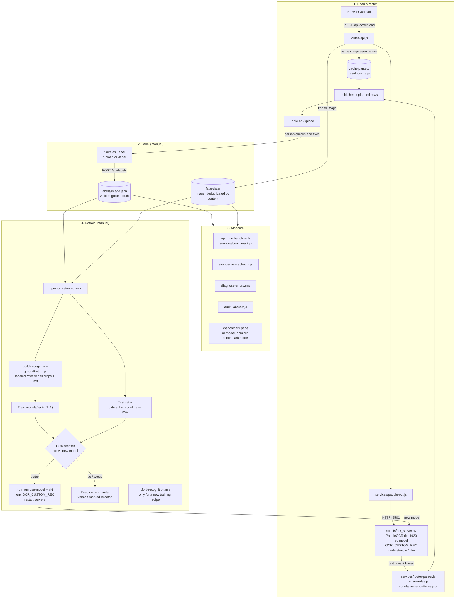

# Node OCR

Reads crew roster screenshots and returns the rows of the two roster tables,
**"Published roster"** and **"Rest of this roster is planned"**, as structured
data (`date, day, duty, dep, begin, end, arr`). Other text on the page is ignored.

Current state (2026-10-08): recognition model **v4** (`models/rec/v4`), parser
row accuracy 97.1% on the labeled rosters (95.6% on 16 rosters the model never
trained on, before the 2026-10-07 parser fixes). Nothing learns or retrains on its own: the model and parser only change
when you run a command and choose to switch.

**New here?** Jump to [Getting started](#getting-started) to install and run it.

## Architecture



Same diagram as plain text (for terminals):

```
 ┌──────────────────────────── 1. READ A ROSTER ─────────────────────────────┐
 │                                                                           │
 │  Browser /upload ──POST /api/ocr/upload──> routes/api.js                  │
 │                                              │  same image seen before?   │
 │                                              ├─yes─> cache/parsed/        │
 │                                              │      (result-cache.js)     │
 │                                              │                            │
 │                                              ▼                            │
 │                                    services/paddle-ocr.js                 │
 │                                              │ HTTP :8501                 │
 │                                              ▼                            │
 │                                    scripts/ocr_server.py                  │
 │                                    PaddleOCR det (1920) +                 │
 │                                    rec model OCR_CUSTOM_REC               │
 │                                    (models/rec/v4/infer)                  │
 │                                              │ text lines + boxes         │
 │                                              ▼                            │
 │                                    services/roster-parser.js              │
 │                                    (+ parser-rules.js,                    │
 │                                     models/parser-patterns.json)          │
 │                                              │                            │
 │                                              ▼                            │
 │          { published: [...], planned: [...] } ──> table on /upload        │
 └───────────────────────────────────┬───────────────────────────────────────┘
                                     │ a person checks / fixes the table
                                     ▼
 ┌──────────────────────────── 2. LABEL (manual) ────────────────────────────┐
 │  upload keeps the image in fake-data/ (deduplicated by content)           │
 │  "Save as Label" on /upload or /label ──POST /api/labels──>               │
 │      labels/<image>.json   (verified ground truth)                        │
 └────────────┬───────────────────────────────────────┬──────────────────────┘
              │                                       │
              ▼                                       ▼
 ┌────── 3. MEASURE ───────┐  ┌──────────── 4. RETRAIN (manual) ─────────────┐
 │ npm run benchmark       │  │ npm run retrain-check                        │
 │ services/benchmark.js   │  │ ├ test = rosters the model never saw         │
 │ (PaddleOCR + parser)    │  │ ├ build-recognition-groundtruth.mjs:         │
 │                         │  │ │   labeled rows -> cell crops + text        │
 │ eval-parser-cached.mjs  │  │ ├ train -> models/rec/v(N+1)                 │
 │ diagnose-errors.mjs     │  │ └ OCR test set with old + new model          │
 │ audit-labels.mjs        │  │     -> better / tie / worse                  │
 │ /benchmark (AI model)   │  │                                              │
 └─────────────────────────┘  │ better? npm run use-model -- vN              │
                              │   -> .env OCR_CUSTOM_REC, restart            │
                              │   -> back to 1 with the new model            │
                              │                                              │
                              │ new recipe? kfold-recognition.mjs            │
                              └──────────────────────────────────────────────┘
```

The four steps:

1. **Read.** `ocr_server.py` finds the text lines and reads them with the fine-tuned
   model. `roster-parser.js` turns those lines into rows of the two tables.
2. **Label.** Only a person writes labels.
3. **Measure.** Scores always compare against `labels/`.
4. **Retrain.** Run by hand. A new model version is used only after
   `use-model` switches to it.

## Getting started

### Requirements

| | Version | Notes |
|---|---|---|
| Node.js | **20.6+** (tested on 20.18) | `npm start` uses `node --env-file` |
| Python | **3.11** (tested on 3.11.3) | for the PaddleOCR server |
| GPU (optional) | NVIDIA, CUDA 11.8 runtime | tested on a GTX 1660 Ti (6 GB). The CUDA/cuDNN DLLs come from pip, no separate CUDA install needed. Without a GPU the server falls back to CPU (much slower). |
| OS | Windows 10/11 | the `npm run ocr-server` / `ocr:check` scripts call `.\.venv\Scripts\python`; on Linux/macOS run them with `.venv/bin/python` (see below) |

### 1. Get the code and install

```powershell
git clone https://github.com/thuannd17/node-ocr.git
cd node-ocr

npm install

python -m venv .venv
.\.venv\Scripts\pip install -r scripts/requirements.txt
```

No NVIDIA GPU? In `scripts/requirements.txt` swap `paddlepaddle-gpu==2.6.2` for
`paddlepaddle==2.6.2` (the line is already there, commented out) and drop the
`nvidia-*` lines before installing.

Linux/macOS: `python3.11 -m venv .venv && .venv/bin/pip install -r scripts/requirements.txt`
(use the CPU package on macOS).

### 2. Configure

```powershell
copy .env.example .env      # Linux/macOS: cp .env.example .env
```

The defaults work as is; everything runs offline. All settings are
listed in [`.env`](#env) below.

### 3. Check the OCR runtime

```powershell
npm run ocr:check           # Paddle/PaddleOCR versions, GPU or CPU, test init
```

### 4. Run

Two processes, in two terminals:

```powershell
npm run ocr-server          # terminal 1: PaddleOCR on http://127.0.0.1:8501 ("Ready" when loaded)
npm start                   # terminal 2: app on http://localhost:3000
```

Linux/macOS terminal 1: `.venv/bin/python -u scripts/ocr_server.py`.

Open <http://localhost:3000>, go to **Upload & OCR** and drop a roster screenshot.
The first OCR after starting the server takes a few seconds longer (model warm-up);
after that about 1 s per image on the GPU above.

Quick checks: <http://127.0.0.1:8501/health> (device, queue) and
<http://127.0.0.1:8501/stats> (requests served, queue/inference time).

### 5. Data (not in git)

Roster images and labels are real crew rosters (personal data), so they are **not
in the repository**:

| Folder | Content | On a fresh clone |
|---|---|---|
| `fake-data/<ext>/` | roster images and duty-plan PDFs, one folder per extension (`jpg/`, `jpeg/`, `png/`, `jfif/`, `pdf/`), each file named `<guid>.<ext>` | created empty on first start; every upload is stored here under a new GUID (deduplicated by content) |
| `labels/<ext>/` | verified labels, `<guid>.<ext>.json` next to the same folder name as its file | created empty; filled by **Save as Label** on `/upload` or `/label` |

Code never builds these paths itself: `utils/data-files.js` (`listData`, `dataFile`,
`labelFile`, ...) resolves a file name to its folder, so training, benchmark and
the app all see the same files. File names are unique across folders, so caches,
`exports/` and `models/rec/*/model.json` refer to files by name only.
The GUID rename of 2026-10-13 kept a map of old -> new names in
`tmp/backup-guid-rename-20261013/mapping.json`.

Upload and OCR work without any data. `/label` and `/benchmark` only have
something to show once images are uploaded and labeled; to reuse an existing
dataset, copy both folders from the machine that has them.

Also local only: `cache/`, `tmp/` and `exports/` (rebuilt by the app and scripts),
and `models/pretrained/` (downloaded, only needed for retraining, see
[Recognition model versions](#recognition-model-versions)).

### Troubleshooting

| Symptom | Fix |
|---|---|
| Upload says *PaddleOCR server is not reachable* | start `npm run ocr-server` and wait for `Ready`; if it runs elsewhere set `OCR_SERVER_URL` |
| Upload says *OCR server đang bận* | more than `OCR_MAX_QUEUE` (default 4) requests were waiting; retry, or raise `OCR_MAX_QUEUE` |
| `EADDRINUSE` (app) or `WinError 10048` / *Address already in use* (OCR server) | port 3000 / 8501 already used (another copy running?): stop it, or change `PORT` / `OCR_SERVER_PORT` (+ `OCR_SERVER_URL`) |
| OCR server exits with a CUDA/DLL error | rerun `npm run ocr:check`; reinstall `scripts/requirements.txt`, or use the CPU package |
| `npm start` fails with `bad option: --env-file` | Node is older than 20.6 |
| Styles missing after an update | restart `npm start` and hard-reload the page (Ctrl+F5) |

## Pages

| Page | Purpose |
|---|---|
| `/upload` | **Try the AI model**: every uploaded roster **image or duty-plan PDF** is read by the learned model (images: PaddleOCR lines -> model), never by the parser and never answered from a saved label. When the file already has a label, the info line shows how many label rows the model got exactly right. The page is read-only (no editing, no saving labels: that is /label). The toolbar holds the file picker (or drop a file anywhere) and, once a result is shown, **↻ Đọc lại** (read again, e.g. after retraining). An image-only PDF (no text layer) is read by OCR: a duty plan by the parser (the model has no words for it); any other one, e.g. a Ryanair eCrew roster screen printed to PDF, has its pages stacked into one tall roster picture that the model reads as an image (and, once labeled, trains on as an image). A PDF shows the PDF and 12 columns; empty optional columns (DC, hotel, registration, AC) are hidden. `/upload?pdf=<file>` reads a stored PDF with the model. |
| `/label` | Folder tree of `fake-data/` (one folder per extension; unlabeled 🆕 first, byte-identical image copies hidden unless asked). Hovering a file shows 🗑: it removes the file from the dataset (after a confirm) by moving it, its label and its cached OCR result to `tmp/trash/<date>/`. Clicking a file opens a popup (Esc / × closes; drag the bar in the middle to resize) with the file next to its label as editable Published / Planned tables (one cell per field, add / insert / delete rows; Enter moves down a column); the label is still saved as JSON (**{ } JSON** shows it). Making ground truth: **Auto-fill** proposes the rows with **Parser** (OCR + `roster-parser.js` for an image, the PDF parser for a PDF) or **AI model** (chosen in the list next to it), and says how many rows match the saved label; check, fix, save. Ctrl+S saves, Alt+↑/↓ moves between files. `/label?name=<file>` opens one. |
| `/benchmark` | Score the AI model (images + PDFs, read as on /upload) against `labels/`, same as `npm run benchmark:model`; each file lists its differences from the label. **Xem & sửa** on a file opens the /label editor in a popup over the page (`/label?embed=1&review=1&name=<file>`): for an image, the table is the label and cells where the model differs are marked (yellow, model value underneath: click to take it), label rows the model missed are blue, rows only the model has are struck through (**+ nhãn** adds one); a PDF opens without the marks. A saved label shows "✓ đã lưu nhãn": run the benchmark again to update the scores. The parser benchmarks (`npm run benchmark`, `npm run benchmark:pdf`) are command-line only. |

New rosters: uploads are deduplicated by content and kept in `fake-data/`. A label
is written only when a person presses **Save as Label**.

## API

| Route | Description |
|---|---|
| `POST /api/ocr/upload` | multipart field `image`; both tables read by the AI model (`source: 'model'`, `vsLabel` when labeled) |
| `GET /api/predict?name=...&engine=parser\|model` | read an image already in `fake-data/` (default parser) |
| `GET /api/pdf/parse?name=...&engine=parser\|model` | read a stored PDF (default model); `&label=true` returns its label when there is one |
| `GET /api/review?name=...` | AI model reading vs label for a labeled image, rows paired like the benchmark |
| `GET /api/labels`, `POST /api/labels` | read / save a label |
| `GET /api/files`, `GET /api/raw` | list images / serve an image |
| `DELETE /api/files?name=...` | remove an image or PDF from the dataset: file, label and cached result move to `tmp/trash/<date>/` |
| `GET /api/benchmark/model/stream`, `POST /api/benchmark/stop` | AI model benchmark, images + PDFs (server-sent events) |
| `/api/models` | model versions per family: list, train, activate, delete (`/models`) |

## PDF duty plans (NetLine/Crew)

`/upload` and `/label` read "Individual duty plan" PDFs exported by NetLine/Crew. Most have a
text layer, so there is **no OCR**: `services/pdf-text.js` reads the words with
their positions (pdfjs-dist; pages printed sideways, e.g. via "Microsoft Print to
PDF", are turned upright) and `services/pdf-roster-parser.js` turns the day
columns into rows. Two layouts are read: 2-3 blocks of `date H duty R dep arr AC
info` per landscape page (days `Sat01`), and the single-column RYR plan `date
stops duty req dep arr AC rank info` (days `01. Sat`; `req` is read like `R`).
A compact variant prints only `date duty dep arr AC` (the period after the name:
"Individual duty plan for ... Period: 31Aug26 -- 06Sep26"); its note "Local time at
homebase or (!) outside homebase" makes plain times `LB`, and the crew ids listed
per flight number under the days ("992 Cockpit:01736 03912" / "Cabin:06366 ...") go
to that flight's **crew** without its airline prefix (NX992):
`[Cockpit - 01736][Cockpit - 03912][Cabin - 06366]...`.
A third layout, the **Crew Roster Report** table (`Date | DC | C/I (Z) | C/O (Z) |
Activity | From | STD (Z) | To | STA (Z) | AC/Hotel | Blk Hrs | Duty Hrs`), gives per
line: a `C/I` row (begin = C/I time), the activity (duty = Activity, dep = From,
begin = STD, arr = To, end = STA, `[Blk Hrs ..]` in info), a `C/O` row (end = C/O
time, `[Duty Hrs ..]` in info), and when AC/Hotel is longer than 3 characters a
hotel row (duty `H`, info = the hotel); the DC column fills `dc`.
A fourth layout, the **Crew member's flight time record** (`flight | date | flightno |
registr | type | dep | off | on | arr | Block Time per Leg` or `1.pilot | 2.pilot | SIM`),
lists flown legs: flightno -> duty, registr -> registration, type -> ac, the two
times -> begin/end, the time columns after arr -> info (`[Block Time 3:12]`); the
`flight` counter is skipped and the "All times in UTC! ..." note is shown as an alert.
A fifth layout, the **crew flight log** (`Year | Month | Date | Dep | Block-Off | Arr |
Block-On | Blocktime | AcType | AcRegId | PiC ...`), lists flown legs: Block-Off/On ->
begin/end, Blocktime -> `[Block Hrs: 03:12]`, AcType -> ac, AcRegId -> registration;
it has no flight number, so duty stays empty, and pilot names are skipped.
A sixth layout, the Spanish **Calendario de actividades** (`Fecha Asignación | Hora
Salida | Hora Salida UTC | Asignación | Descripción Asignación | ORI/DES | Hora Llegada |
Hora Llegada UTC | Nro Vuelo`): day + date from "Lunes 01/07/2024", begin/end as
`05:00 Z / 00:00 L` (UTC, then local), duty = Asignación (`L`, `SOBREAVIS`) or Nro
Vuelo, dep/arr = ORI/DES, info = Descripción Asignación as printed.
Two **Personal Crew Schedule Report** layouts (times local, "L", or "Z" when the period line says "All times in UTC", which is shown as an alert): the **grid** (one
column per day "01/07": C/I time, flights as number / dep time / dep / arr / arr time /
[AC], C/O time, or a duty code with its times; "→" … "↓" = landing after midnight,
end "00:05 L +1"; the "Other Crew" table lists the crew of one flight of a duty, and
every flight of that duty from C/I to C/O gets it in **crew**; its date may be the UTC
day, so the flight is also looked for a day later or earlier; Wizz Air's variant
wraps flight numbers "WAZ701" + "5" -> `WAZ7015` ("WMT28" + "25"), gives some duties a
route ("PCAR55" 15:30 "*VIE" "BUD" 18:30 -> dep/arr, "*" kept), a C/I before a timed duty
too ("20:05" "ST" "21:35"), continues the Descriptions on the next page, prints actual times "A02:00" (kept: `A02:00 Z`),
"(L)" and "Delay 00:50" -> info, day indicators S / L / D under the grid -> the day's
first row, and its F / D daily totals are not read; hotel nights -> `H` rows), and the **Schedule Details** table (`Date | Duties | Details |
Report times | Actual times/Delays | Debrief times | Indicators | Crew`, cells centred
in each day's row): report -> C/I row, debrief -> C/O row, details "*BCN - BIO" ->
dep/arr ("*" kept), other details -> `[OFF: Day off]`, actual times -> begin/end ("A07:12 L", "E13:00 L": the A/E stays; a
delay "/01:41" -> `[Delay 01:41]`), the day's crew in the **crew** column of
each of its flights (flight number with a route) (`[CP - DHC - 1096 - CASANOVAS][FO - 2151 -
EREZUMA]`), its indicators and memos (`[M: Day Memo] [Memo: ...]`) on its first
row, and one `H` row per night of the
"Hotel Information" table (dep = port, info = address, phone). Both give duty codes
and indicators their "Descriptions" text: `[KU4: KUL Home Standby]`.
Days only carry a day number, so the month is counted from the period start; when
a later page range was printed, the first month whose weekdays all match is used.

A PDF **without** a text layer (e.g. printed from a browser as an image) is
rendered page by page and read by the OCR server (`services/pdf-ocr.js`, needs
`npm run ocr-server`); typical OCR slips (header words, "Sa227", "8325",
statistics without brackets) are repaired before the same parser runs, and
`/upload` warns that the result needs checking.


Like the image rosters, the result has two tables: **published**, and **planned**
for the days after "The following is only for information because the published
period ends" (or "... a round trip ending outside the printed period").

| Field | From |
|---|---|
| `date`, `day` | `Sat01` + the period in the header -> `1 Mar 25`, `Sat`; every row repeats its day's date |
| `dc` | Duty Code column of a Crew Roster Report (`FO`, `DH`, `R*`), on the activity row only (not on C/I or C/O); empty in NetLine plans |
| `hotel` | the H column: a layover line `H1* BOG` is a row of its own (hotel `H1*`, dep `BOG`, info = name and phone from the *Hotels* table) |
| `duty` | `C/I`, `C/O`, `STBY`, `OFF`, flight number (`EW 7526`), training codes, ... one row each (empty on hotel rows) |
| `registration` | the R column: on the row (`R`) or an aircraft code on the line under a leg (`A321`, `D-AIZA`); any other text there goes to `info` |
| `dep`, `arr`, `ac` | as printed (`HAM`, `FUE`, `320`) |
| `begin`, `end` | one format for every layout: `06:05 Z` (UTC), `07:00 B` (homebase, plans noted "(!) if not in homebase timezone"), `07:00 LB` (local at the departure airport, "(!) if not in departure airport timezone"), `07:00 L` also for plans noted "All CI/CO times are local", `13:00 L` (local, printed `!1300`), `05:00 Z / 00:00 L` only when the PDF gives both; a day offset stays (`22:00 Z -1`); `0900 !1145` printed as one piece is split into begin and end |
| `info` | the duty statistics, e.g. `[DT 12:30] [FDT 12:30] ...` or `[FT 03:10][DT 05:35]...`, on the row they start next to |
| `info` (text) | other text in the info column on the event's line (`72049 ALTC`) or wrapping onto the lines under it (`KURJAKOV` / `OBS`), and the text lines under the event (`Instructor, LC`, `EATC Rzeszow` / `**` / `BGR CAE` ...), in reading order |
| `info` (crew message) | "To c/m: ..." / "From c/m: ..." with its wrapped lines, on the event of that line or else the event before |
| `info` (legend) | a duty code listed in *Absence/Ground Activity Legend* (`STBY`, `DBF`, `--`, ...) adds its description, e.g. `[STBY: Standby]` |

Notes printed on the *Period:* line ("Local times at event airport. (!) if not in homebase timezone", "All CI/CO times are local") are shown as an alert above the table on `/upload`. Info of an item: statistics, then the legend description. Statistics printed under a hotel line still belong to the item before it. The other tables after the last day (crew lists, totals, training expiry, contacts) are skipped.

Same loop as for images: upload on `/upload`, check and fix the table, **Save as
Label** (`labels/pdf/<file>.json`, `{ published: [...], planned: [...] }`), then measure:

```powershell
npm run parse-pdf -- "fake-data/pdf/<file>.pdf"   # print the parsed rows
npm run benchmark:pdf                              # parser vs labels/pdf/
```

PDFs are kept in `fake-data/pdf/`, labels in `labels/pdf/`; both are personal
data and not in git.

### Learned extractor (the AI model used by /upload)

An offline model, trained from all labels (`labels/pdf/` and the image labels),
reads layouts without new parser code. `/upload` always uses it, to try out
each newly trained model; `/label` Auto-fill can use it or the parser to make
ground truth. The loop: label files on `/label` (or **Save as Label** on
`/upload`), then **Train** on `/models` (or `npm run train:pdf`, ~7 min
for 44 PDFs + 94 images; image OCR lines are cached in `exports/ocr-lines/`, so
only new images need the OCR server). One labeled file of a layout is usually
enough to read the others.

| Piece | What it does |
|---|---|
| `services/pdf-tokens.js` | words of the text layer with positions |
| `services/pdf-label-align.js` | training tags from a label alone: which words hold each row's values (so files the parser misreads still teach the model) |
| `scripts/build-pdf-token-data.mjs` | tags of every labeled PDF -> `exports/pdf-tokens/` (the parser's trace where it equals the label, else the label alignment) |
| `services/ocr-tokens.js`, `scripts/build-image-token-data.mjs` | OCR lines of a labeled image -> words with positions, tagged from its label -> `exports/image-tokens/` |
| `scripts/pdf_tagger.py`, `scripts/train_pdf_tagger.py` | the word tagger (scikit-learn, two stages: word + column-header features, then the neighbours' fields); every layout weighs the same in training |
| `services/pdf-row-assembler.js` | tagged words -> rows (blocks, dates, C/I-C/O, hotels, time zones, legend; how `[Blk Hrs 3:25]` is written is learned from the labels) |
| `scripts/train-pdf-model.mjs` | the whole retrain -> `models/pdf-tagger/` (previous one kept in `models/pdf-tagger-prev/`; not in git) |
| `services/pdf-ai-extract.js` | the app side: runs `scripts/pdf_tagger_predict.py` (~3-4 s per file) and assembles the rows (`extractWithModel` for PDFs, `extractImageWithModel` for images) |

Measured on the 44 labeled PDFs (rows with all 12 fields right, each file read
by a model that never saw it): layouts already labeled 92.6%; a new layout after
labeling one file of it 84.6%; a layout never labeled 58%. On images, a model
trained with the images read 86.8% of rows when it had not seen the image
(images it trained on: 88.2%; the image parser: 97.0%). The parser stays the
better tool for making labels of the layouts it knows.

```powershell
npm run train:pdf                                   # retrain from labels/pdf/
npm run eval:pdf-model                              # assembler on the true tags
.venv/Scripts/python scripts/train_pdf_tagger.py --predict one   # tags for "one labeled file" ...
npm run eval:pdf-model -- --pred exports/pdf-tokens-pred/one     # ... and their rows
```

## `.env`

```ini
HOST=localhost
PORT=3000

# PaddleOCR
OCR_WORKERS=1
OCR_FAST_MODE=1
OCR_WARMUP=1
OCR_CUSTOM_REC=models/rec/v4/infer    # recognition model in use (see npm run use-model)
OCR_TEXT_DET_LIMIT_SIDE_LEN=1920      # do not downscale; 736 merges table rows
OCR_TIMEOUT_MS=300000
# OCR_SERVER_URL=http://127.0.0.1:8501   # where the app finds the OCR server
# OCR_SERVER_PORT=8501                   # port the OCR server listens on
# OCR_MAX_QUEUE=4                        # requests allowed to wait; more get "busy" (503). 0 = unlimited
```

Restart `ocr-server` and the app after changing `.env`.

The OCR server sets Paddle's GPU allocator itself (`FLAGS_allocator_strategy=naive_best_fit`,
in `scripts/ocr_server.py`): with Paddle's default the server slowed from ~0.8 s to
~2.8 s per image as GPU memory grew. It is not in `.env` on purpose, so training
runs keep Paddle's default.

## Concurrent requests

The OCR server holds one model and OCRs **one image at a time**; other requests
wait in line (about 0.8 s per image ahead of you on a GTX 1660 Ti). Up to
`OCR_MAX_QUEUE` requests wait; beyond that the server answers `503 busy` at once
and `/upload` shows "OCR server đang bận". Running a second OCR server on the same
6 GB GPU was measured to be much slower, not faster.

```powershell
node --env-file=.env scripts/load-test.mjs --url http://127.0.0.1:8501 --concurrency 1,2,4,8
```

reports throughput, latency and how much of it was queueing vs inference
(`queueMs` / `inferMs`, also returned by every `/ocr` call).

## Measuring accuracy

These need labeled rosters in `fake-data/` + `labels/` (see [Data](#5-data-not-in-git)).

```powershell
npm run benchmark                                       # full run against labels/
node --env-file=.env scripts/benchmark.mjs --strategy=paddleocr --json
node scripts/eval-parser-cached.mjs                     # parser only, from cached OCR lines (seconds)
node --env-file=.env scripts/diagnose-errors.mjs        # which pipeline stage each wrong field came from
npm run audit-labels                                    # spot label typos
npm test
```

Read `aggregate.rowExactMatchRate` and `aggregate.perField.<field>.matches/.total`
from the JSON. The `(NN%)` next to an error type in the CLI summary is the share
of that field's errors, **not** an error rate. When comparing two models, compare
the number of correct rows on the same images, not only the percentage.

## Recognition model versions

Each version is `models/rec/vN/`: `infer/` (loaded by the OCR server),
`model.json` (recipe, rosters trained/tested on, result, status), `train.yml`,
`train.log`. `models/rec/stock` is the unmodified PaddleOCR model.

In git: the weights of `stock` and the deployed `v4`, plus the metadata of v1–v4.
Training checkpoints, `split.json` files and the rejected v5–v7 stay local (their
metadata lists roster image names).

| Version | Status |
|---|---|
| v1 | first real fine-tune (2026-09-22) |
| v2 | anchor recipe, deployed 2026-09-25 |
| v3 | table-only, never deployed (planned table got worse) |
| **v4** | **tight recipe, deployed 2026-10-01** |
| v5 | retrain with +16 rosters, tie, rejected (2026-10-07) |
| v6 | retrain with 17 test rosters, tie (1337 vs 1338 rows), rejected (2026-10-07) |
| v7 | rejected (2026-10-08) |

```powershell
npm run use-model                    # list versions, * = in use
npm run retrain-check -- --status    # how many labeled rosters the current model never saw
npm run retrain-check                # train v(N+1) and compare (~45 min + OCR)
npm run use-model -- v8              # switch only if the verdict was "better", then restart both servers
```

Retraining needs the PaddleOCR pretrained recognition model (not in git, 195 MB
unpacked), referenced by `models/rec/train-template.yml`:

```powershell
curl -L -o en_PP-OCRv3_rec_train.tar https://paddleocr.bj.bcebos.com/PP-OCRv3/english/en_PP-OCRv3_rec_train.tar
mkdir models\pretrained
tar -xf en_PP-OCRv3_rec_train.tar -C models/pretrained    # -> models/pretrained/en_PP-OCRv3_rec_train/best_accuracy.*
```

It also needs labeled rosters in `fake-data/` + `labels/`.

`retrain-check` tests on every labeled roster the deployed model has never seen
(needs at least 5, `--min-new=N`), trains the next version on everything else with
`models/rec/train-template.yml`, OCRs the test rosters with both models and scores
them with the current parser. Verdict: better / tie / worse (margin
max(3 rows, 0.5%)). It never edits `.env`, and deletes the 750 MB training
checkpoint unless `--keep-checkpoint`.

- **Progress:** each step shows a status line (epoch, step, %, ETA during training;
  images done during OCR). Full output goes to `models/rec/_pending/train.log`.
- **Resumable:** rerun the same command after a stop; finished steps are skipped
  and training continues from the last finished epoch (`--restart` starts over).
- **No repeats:** if the deployed model, train/test rosters and epochs are the same
  as an existing version (e.g. right after a rejected one), it says so and stops;
  label more rosters, or `--force`.
- **No evaluation during training** (since 2026-10-07): it only chose
  `best_accuracy`, which is never exported, and cost ~22% of training time. An
  epoch went from 4.4 to 2.9 min.

Training tips:

- Run training alone on the GPU (no OCR server or benchmark at the same time) and
  make sure only one `tools/train.py` process is running.
- Don't override `Global.epoch_num` to stop early; it reshapes the cosine LR
  schedule.
- Check a new model on full images too, not only on crops: an earlier fine-tune
  without general text forgot how to read headers and dates.

## Project layout

```
index.js                     app entry
routes/api.js, views.js      API + pages
views/                       upload, label, benchmark, home
views/assets/                shared stylesheet + top menu (nav.js)
services/paddle-ocr.js       OCR client (resize, call server, parse, quality)
services/roster-parser.js    OCR lines -> table rows
services/benchmark.js        scoring
scripts/ocr_server.py        PaddleOCR server (GPU auto-detect, CPU fallback)
scripts/*.mjs                benchmark, eval, retrain-check, use-model, load-test, ...
scripts/requirements.txt     Python dependencies of the OCR server
services/pdf-*.js            PDF duty plans: text + positions, parser, benchmark
routes/pdf-api.js            /api/pdf/* (upload, parse, labels, benchmark)
models/rec/                  recognition model versions
models/parser-patterns.json  fixed parser config
.env.example                 settings template (copy to .env)

local only (not in git):
fake-data/<ext>/             roster images and duty-plan PDFs (<guid>.<ext>)
labels/<ext>/                verified labels (<guid>.<ext>.json)
cache/, tmp/, exports/       OCR lines, upload results, datasets
models/pretrained/           base model for retraining
```
